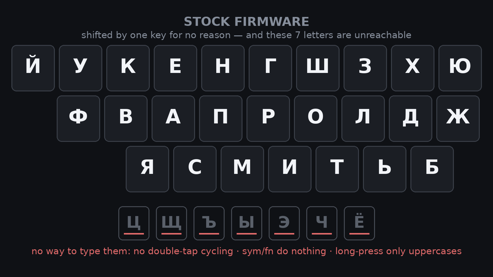
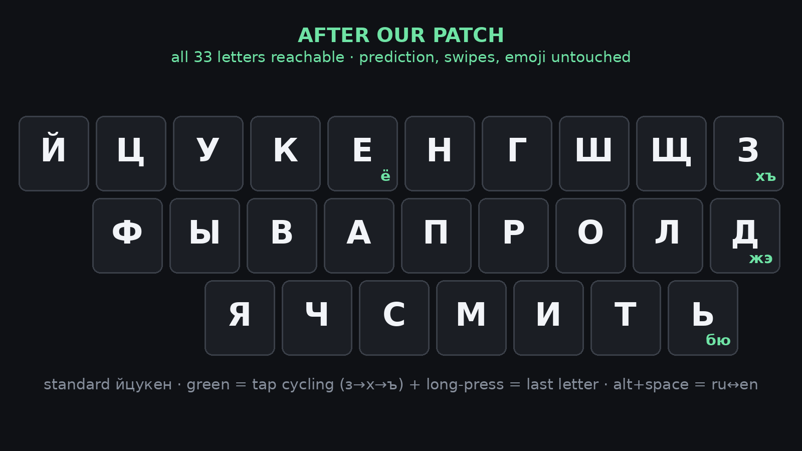

<div align="center">

# ⌨️ TitanElite2RUkeyboard

**Standard ЙЦУКЕН on the Unihertz Titan 2 Elite physical keyboard — by patching the stock IME**


[What & why](#what--why) · [Layouts](#layouts) · [Features](#features) · [How it works](#how-it-works) · [Reproduce](#reproduce) · [Limitations](#limitations) · [References](#references) · [Читать по-русски](#русский)

</div>

## What & why

The Titan 2 Elite ships with a 26-key physical QWERTY and a Russian layout baked
into its stock IME (IQQI/Kika, `/product/app/KikaInputMethod`). That layout is
**not ЙЦУКЕН** — it is shifted and remapped (`W=У, S=В, X=С, P=Ю, M=Б`), so
anyone with desktop muscle memory is lost. Worse, 7 letters (**Ц Щ Ъ Ы Э Ч Ё**)
cannot be typed at all: Sym, Fn, double-tap and long-press produce nothing
(long-press only uppercases).

The Android-native fix — a KCM keyboard-layout provider — **does not work on
this device**: on the Elite (Android 16) per-language layout assignments never
reach the hardware (they do on the regular Titan 2; see
[mellen9999/titan-layout](https://github.com/mellen9999/titan-layout), where
the provider approach originates).

So this project patches the stock IME itself:

- the stock APK is cloned into an independent package
  (`com.iqqijni.bbkeyboardjc`, shown as **“Kika ЙЦУКЕН”**),
- its physical-key letter table is rewritten to standard ЙЦУКЕН,
- a small injected class (`jc.Tail`) adds the missing letters via
  **tap cycling and long-press** on the row-end keys, plus a live
  **RU ⇄ EN toggle on Alt+Space**.

Because it *is* the stock app, every soft-keyboard feature survives:
prediction bar, swipe word-selection, cursor gestures, emoji, voice input.

## Layouts

**Stock firmware** — the RU layout as the phone actually maps it: shifted off
ЙЦУКЕН by one key, and seven letters have no key at all. There is no double-tap
cycling, Sym/Fn give nothing, long-press only uppercases — ц щ ъ ы э ч ё
simply cannot be typed:



**After the patch** — standard ЙЦУКЕН on all keys. The green corner marks are
the recovered letters: tap the key repeatedly to cycle (`е→ё`, `з→х→ъ`,
`д→ж→э`, `ь→б→ю`), or hold it for the last letter of the cycle. Alt+Space
switches RU ⇄ EN on the fly:



## Features

| Action | Result |
|---|---|
| Base keys | Standard ЙЦУКЕН: `Q=Й W=Ц E=У R=К T=Е … Z=Я X=Ч C=С V=М B=И N=Т M=Ь` |
| `P` tap · tap · tap | `з → х → ъ` (cycling, 700 ms window, case preserved) |
| `L` tap · tap · tap | `д → ж → э` |
| `M` tap · tap · tap | `ь → б → ю` |
| `T` tap · tap | `е → ё` |
| Hold `P / L / M / T` | always the farthest letter: `ъ / э / ю / ё` |
| Hold any other key | stock behaviour (uppercase) |
| **Alt+Space** | RU ⇄ EN instantly, in the current field |
| Ctrl+Space | show/hide the on-screen keyboard (stock behaviour) |
| First keypress after install | Russian enables automatically — no setup dance |

## How it works

Three smali hooks + one injected Java class:

1. `HDKeyboardService.onKeyDown(I, KeyEvent)` — first instructions call
   `jc.Tail.onKey(service, event)`; handles multitap cycling, auto-repeat
   long-press, Alt+Space language switching and the first-keypress
   auto-Russian.
2. `HDKeyboardService.onKeyLongPress` — calls `jc.Tail.longPress` (the
   FLAG_LONG_PRESS re-dispatch path).
3. `h3/c.p(KeyEvent)` — delegate into `jc.Tail` (the pipeline delivers a
   *clone* of each KeyEvent here; `jc.Tail` deduplicates by value).
4. `h3/b` — the C-array (2×26 letter table) rewritten to standard ЙЦУКЕН.

`jc.Tail` is compiled to `classes2.dex` (d8, `--release --min-api 21`) and
added to the APK after the apktool build. The live language switch drives the
stock engine through its own internals (`l3/i.y/q`, `m3/b.U()`, `h3/c.t`,
`o()`, engine `k(Locale)`, then a forced `onStartInput`) — documented in
[reference/kika-internals.md](reference/kika-internals.md).

## Reproduce

Prerequisites: a Titan 2 Elite with USB debugging, `adb`, `docker`
(x86_64 images via Rosetta on Apple Silicon).

```bash
./scripts/decode-patch.sh   # pull stock APK, decode, apply patches, make keystore
./scripts/build.sh          # compile jc.Tail, build + sign dist/kika-jc.apk
./scripts/install.sh        # install on device and bind the IME
```

Then type. The first keypress switches the clone to Russian by itself.

> [!IMPORTANT]
> The clone is self-signed and installed **next to** the stock IME (different
> package name) — the stock app stays untouched. After a **phone reboot** the
> ROM resets the default IME to stock (`ro.agui.inputmethod_default`); simply
> reselect “Kika ЙЦУКЕН” in system settings.

## Limitations

> [!NOTE]
> Honest list — these are real behaviours we measured, not guesses.

- Fields that carry English EditorInfo hints (Keep's search box, Chrome's
  omnibox) force the latin layout **by the app's own locale hints** — this is
  stock per-field behaviour of the Kika engine and affects the stock IME too.
- Flick typing (swipe gestures on the physical keys) **does not work with the
  clone** — it is a ROM-level feature (`flick_typing_enabled` is read by
  framework.jar/services.jar); investigation status in
  [reference/flick-typing-notes.md](reference/flick-typing-notes.md).
- Reboot resets the default IME (see above).
- The layout table and hook offsets are verified against IME **v167**;
  a firmware update that bumps the IME likely needs re-patching (the decode
  script re-applies everything from the new stock APK automatically).

## References

- [reference/titan_jcuken.json](reference/titan_jcuken.json) — layout spec
- [reference/stock-layout-map.md](reference/stock-layout-map.md) — extracted stock RU map + device notes
- [reference/kika-internals.md](reference/kika-internals.md) — reverse-engineered Kika engine internals
- [reference/flick-typing-notes.md](reference/flick-typing-notes.md) — flick typing status
- [patches/](patches/) — drop-in patched smali + manifest
- [mellen9999/titan-layout](https://github.com/mellen9999/titan-layout) — the KCM-provider approach (works on regular Titan 2, not on Elite)

## License

MIT © 0x3654 — see [LICENSE](LICENSE). The patched artifacts derive from
Unihertz's preinstalled IQQI/Kika IME and are for personal use on your own
device.

---

# Русский

<div align="center">

**Стандартный ЙЦУКЕН на физической клавиатуре Unihertz Titan 2 Elite — патчем штатной клавиатуры**

[Что и почему](#что-и-почему) · [Раскладки](#раскладки) · [Возможности](#возможности) · [Как устроено](#как-устроено) · [Повторить](#повторить) · [Ограничения](#ограничения-1)

</div>

## Что и почему

Штатная русская раскладка Titan 2 Elite — **не ЙЦУКЕН**: она сдвинута и
перепутана (`W=У, S=В, X=С, P=Ю, M=Б`), пальцы с десктопа не попадают. Хуже:
7 букв (**Ц Щ Ъ Ы Э Ч Ё**) недостижимы вообще — Sym, Fn, двойной тап и
долгое нажатие ничего не дают (долгое нажатие — только заглавная).

Штатный для Android путь — KCM-провайдер раскладок — **на Elite (Android 16)
не работает**: назначения раскладок по языкам до железа не доходят (на обычном
Titan 2 работают; оттуда идея — [mellen9999/titan-layout](https://github.com/mellen9999/titan-layout)).

Поэтому здесь патчится сама клавиатура: стоковый APK клонируется в отдельный
пакет (`com.iqqijni.bbkeyboardjc`, «**Kika ЙЦУКЕН**»), таблица букв для
физклавиатуры переписывается в стандартный ЙЦУКЕН, а встроенный класс
`jc.Tail` добавляет недостающие буквы **циклом по тапам и долгим нажатием**
на крайних клавишах рядов + живой переключатель **RU ⇄ EN на Alt+Space**.
Поскольку это и есть стоковое приложение — сохраняются все его фишки:
строка подсказок, свайпы, эмодзи, голосовой ввод.

## Раскладки

**Сток** — «русская» раскладка, как её реально мапит прошивка: сдвинута от
ЙЦУКЕН на одну клавишу, и у семи букв вообще нет клавиши. Тап-тап нет,
Sym/Fn ничего не дают, долгое нажатие — только заглавная: набрать
ц щ ъ ы э ч ё невозможно никак:


**После патча** — стандартный ЙЦУКЕН на всех клавишах. Зелёные уголки —
возвращённые буквы: повторные тапы по клавише циклят (`е→ё`, `з→х→ъ`,
`д→ж→э`, `ь→б→ю`), удержание даёт последнюю букву цикла. Alt+Space
переключает RU ⇄ EN на лету:


## Возможности

| Действие | Результат |
|---|---|
| Базовые клавиши | Стандартный ЙЦУКЕН: `Q=Й W=Ц E=У R=К T=Е … Z=Я X=Ч C=С V=М B=И N=Т M=Ь` |
| `P` тап · тап · тап | `з → х → ъ` (цикл, окно 700 мс, регистр сохраняется) |
| `L` тап · тап · тап | `д → ж → э` |
| `M` тап · тап · тап | `ь → б → ю` |
| `T` тап · тап | `е → ё` |
| Зажать `P / L / M / T` | всегда последняя дальняя буква: `ъ / э / ю / ё` |
| Зажать прочие клавиши | как в стоке (заглавная) |
| **Alt+Space** | RU ⇄ EN мгновенно, в текущем поле |
| Ctrl+Space | показать/скрыть экранную клавиатуру (сток) |
| Первый знак после установки | русский включается сам — без настройки |

## Как устроено

Три смали-хука + один внедрённый класс: `HDKeyboardService.onKeyDown` (весь
цикл тапов, автоповтор, Alt+Space, авто-русский), `onKeyLongPress`
(перезапуск FLAG_LONG_PRESS), `h3/c.p()` (дубль события — дедупликация по
значению), таблица C в `h3/b` → ЙЦУКЕН. `jc.Tail` компилируется в
`classes2.dex` и добавляется после сборки apktool. Живое переключение языка
гоняет штатный движок через его же внутренности — вся карта движка в
[reference/kika-internals.md](reference/kika-internals.md) (там же — все
грабли: клонирование KeyEvent, лаг коммита, пер-полевая локаль).

## Повторить

Нужны: Titan 2 Elite с USB-отладкой, `adb`, `docker`.

```bash
./scripts/decode-patch.sh   # слить стоковый APK, декодировать, наложить патчи, создать ключ
./scripts/build.sh          # собрать и подписать dist/kika-jc.apk
./scripts/install.sh        # поставить на телефон и включить
```

Первое же нажатие клавиши само включит русский.

> [!IMPORTANT]
> Клон подписан своим ключом и ставится **рядом** со стоком (другое имя пакета)
> — сток не трогается. После **перезагрузки телефона** прошивка возвращает
> стоковую клавиатуру по умолчанию (`ro.agui.inputmethod_default`) — просто
> заново выберите «Kika ЙЦУКЕН» в настройках.

## Ограничения

> [!NOTE]
> Честный список — всё это измерено на живом устройстве.

- Поля с английскими подсказками локали (поиск в Keep, омнибокс Chrome)
  принудительно дают латиницу — это штатное поведение движка Kika для таких
  полей, у стоковой клавиатуры то же самое.
- Flick typing (свайпы по клавишам) с клоном **не работает** — это фича
  прошивки (`flick_typing_enabled` читают framework.jar/services.jar);
  статус расследования — [reference/flick-typing-notes.md](reference/flick-typing-notes.md).
- После перезагрузки телефон возвращается на стоковую клавиатуру (см. выше).
- Таблицы и оффсеты проверены на IME **v167**; обновление прошивки с новой
  версией клавиатуры потребует перепатча (скрипт decode-patch применит всё к
  новому стоковому APK автоматически).

## Лицензия

MIT © 0x3654 — [LICENSE](LICENSE). Патченные артефакты производны от
предустановленной клавиатуры IQQI/Kika (Unihertz) и предназначены для
личного использования на собственном устройстве.
